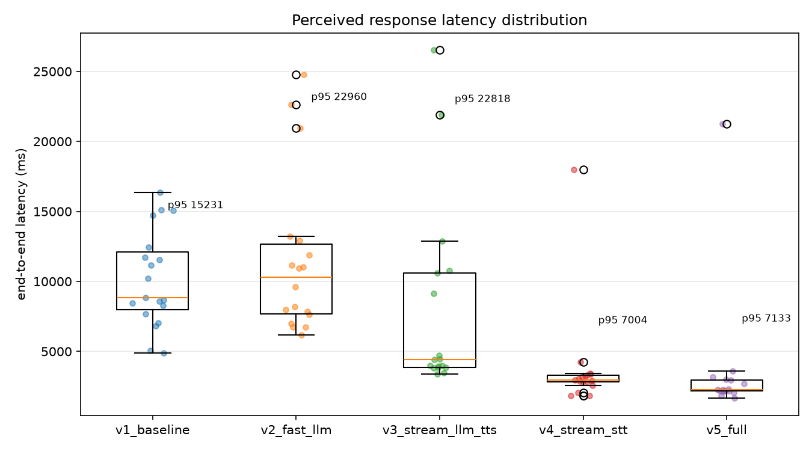

# Low-Latency Voice Agent

A real-time spoken conversational agent — mic in, speech out — built to
answer one question: **where does the latency actually go, and how much of
it can be removed without changing what the agent says?**

The pipeline is instrumented end to end on a single monotonic timeline, and
every optimization is a configuration flag rather than a separate branch of
code, so every latency improvement below is attributable to one specific,
isolated change.

```
Mic / recorded prompt ──► VAD / endpointing ──► STT ──► LLM ──► TTS ──► Speaker
                          │                     │       │       │       │
                          └── every arrow timestamped on one monotonic timeline ──┘
```

Full writeup, per-stage numbers, and answers to the standard "why did you
optimize this and not that" questions live in **[REPORT.md](REPORT.md)**.

## Results

100 turns attempted (20 fixed prompts × 5 profiles), 90 completed
successfully; the rest failed to genuine network conditions, not bugs (see
REPORT.md §6 for why, and what that reveals about the pipeline's
resilience).

| | `v1_baseline` (before, n=20) | `v5_full` (after, n=17) | Change |
|---|---|---|---|
| Median end-to-end | 9563 ms | 3439 ms | **−64%** |
| p95 end-to-end | 14615 ms | 4503 ms | **−69%** |



## The five profiles

One codebase, five configurations, each turning on one more optimization
than the last. `v1` vs. `v5` is the headline before/after; the three steps
in between are the ablation that makes the reasoning behind it defensible.

| Profile | What it adds |
|---|---|
| `v1_baseline` | Nothing streams. Batch STT → non-streaming LLM (larger `gpt-oss-120b`) → batch TTS, strictly sequential. |
| `v2_fast_llm` | Swap to the smaller, faster LLM (`gpt-oss-20b`) — still fully sequential. |
| `v3_stream_llm_tts` | Stream LLM tokens, sentence-chunk them, and stream the resulting audio into TTS as each chunk is ready. |
| `v4_stream_stt` | Streaming STT over a websocket — the transcript is ready essentially the instant the user stops talking. |
| `v5_full` | Server-side endpointing (~300 ms) in place of a fixed silence timer, replacing raw silence-duration with a judgment of linguistic completeness. |

Both the LLM and STT/TTS run entirely on Groq and Deepgram. OpenAI (the
originally planned baseline of Whisper + GPT-4o) was dropped: it requires a
funded billing account with no free tier, which wasn't available here — see
REPORT.md §1 and §6 for how that reshaped the baseline definition, without
collapsing the five-step ablation into something less rigorous.

## Quickstart

```powershell
.\.venv\Scripts\Activate.ps1        # every new terminal
python check_setup.py               # verify keys, audio devices, providers
python demo.py --profile v5_full    # live mic demo of the optimized pipeline
python benchmark.py --profiles all  # the full 100-turn instrumented run
python analyze.py                   # tables + charts from the latest run
```

Setup, from scratch, in short:

1. **Get API keys** — Groq (console.groq.com) and Deepgram (console.deepgram.com) both free, no card required.
2. **Create the environment**: `python -m venv .venv`, activate it, then `pip install -r requirements.txt`. Package versions in `requirements.txt` are deliberately unpinned — recent Python versions only ship prebuilt wheels for recent package versions, and pinning forces pip to compile from source.
3. **Configure**: `copy .env.example .env`, then paste in the two keys.
4. **Verify**: `python check_setup.py`. This plays a beep, records and plays back a mic sample, and pings both providers — every line should read `[PASS]`. If the microphone check fails, run `python fix_mic.py`, which probes every input device and rate and tells you exactly what to put in `.env`.
5. **Build the test set**: `python make_prompts.py --mode record` records 20 fixed prompts once; every profile is then benchmarked against byte-identical audio, so the before/after comparison measures the pipeline, not variation in how a question happened to be asked that time. `python make_prompts.py --mode verify` confirms all 20 are usable.

## Running the live demo

```powershell
python demo.py --profile v5_full
```

Wear headphones — otherwise the mic picks up the agent's own reply and it
ends up talking to itself. It listens, transcribes, replies, and prints a
per-turn latency breakdown after each turn; `Ctrl+C` to stop. Compare it
directly against the baseline to feel the difference:

```powershell
python demo.py --profile v1_baseline
```

## Running the benchmark

```powershell
python benchmark.py --profiles all
```

Replays all 20 recorded prompts through all 5 profiles in real time —
roughly 30-40 minutes depending on network conditions, since a portion of
that time is genuinely just the recordings and the agent's spoken replies
playing out. Every turn is appended to `logs/bench.jsonl` regardless of
whether it succeeded, so a run can be resumed or re-analyzed without
re-running it. For a faster before/after pass:

```powershell
python benchmark.py --profiles v1_baseline v5_full
```

Then:

```powershell
python analyze.py
```

writes `reports/summary.md` (the tables), `reports/per_turn.csv` (raw data
behind every number in the report), and `reports/breakdown.png` /
`reports/distribution.png` (the charts embedded in REPORT.md).

## How the measurement works

Every turn records **one monotonic timeline** (`time.perf_counter`, never
`time.time`) in `agent/metrics.py`. All metrics are derived by subtraction
from that single timeline, so they stay internally consistent by
construction, and the full event history for a turn can be re-examined
after the fact from `logs/bench.jsonl` without re-running anything.

| Mark | Meaning |
|---|---|
| `speech_end_true` | Ground truth: the last audio block containing real signal |
| `eot_detected` | The moment the system *decided* the turn had ended |
| `stt_final` | Final transcript in hand |
| `llm_request_sent` | LLM request dispatched |
| `llm_first_token` / `llm_last_token` | First / last token off the wire |
| `tts_request_sent` / `tts_first_audio` | TTS dispatched / first audio byte received |
| `playback_start` | First sample actually written to the sound card |

```
end-of-speech detection = eot_detected      - speech_end_true
speech-to-text          = stt_final         - eot_detected
LLM time-to-first-token = llm_first_token   - llm_request_sent
LLM total response      = llm_last_token    - llm_request_sent
TTS time-to-first-audio = tts_first_audio   - tts_request_sent
end-to-end (perceived)  = playback_start    - speech_end_true
```

**One subtlety worth knowing going in:** in the streaming profiles, LLM
generation, TTS synthesis, and playback overlap in time, so the per-stage
numbers above do **not** sum to end-to-end — adding them double-counts the
overlapping work. `Turn.critical_path()` in `agent/metrics.py` instead
computes seven contiguous, non-overlapping segments that *do* sum exactly to
that turn's end-to-end. (Per turn only: the median of each segment, summed,
is not the median end-to-end, because medians don't add.) Per-stage numbers
answer "how fast is each component";
critical path answers "where does the time actually go." REPORT.md uses
both, deliberately, for different questions.

## Project layout

```
voice-agent/
├── agent/
│   ├── config.py        the five profiles - every optimization is a flag here
│   ├── metrics.py        Turn timeline, metric derivation, JSONL logging
│   ├── audio_io.py       MicSource, WavSource, VAD, downsampler, Player
│   ├── stt.py             Deepgram batch + streaming websocket
│   ├── llm.py             Groq, streaming and non-streaming
│   ├── tts.py             Deepgram Aura + the sentence chunker
│   ├── net.py             shared retry helper for transient network errors
│   └── pipeline.py       orchestrator - runs every profile through the same code path
├── check_setup.py        verify keys, audio devices, providers
├── fix_mic.py             microphone diagnostic
├── make_prompts.py       build/verify the 20 fixed test prompts
├── import_recordings.py  import prompts recorded on a phone
├── demo.py                live microphone demo
├── benchmark.py           the replay harness that produces logs/bench.jsonl
├── analyze.py             stats + charts from logs/bench.jsonl
└── REPORT.md              full writeup: measurements, reasoning, interview answers
```

## Environment notes

A few non-obvious things this codebase handles, worth knowing if you're
reading the source:

- **No `audioop`.** Python 3.13 removed it (PEP 594); all PCM math here is
  numpy instead.
- **Sample rate conversion.** Many Windows mics only expose a native rate
  other than 16 kHz (what the STT providers require). `audio_io.py` captures
  at the device's native rate and decimates down with a windowed-sinc
  anti-aliasing filter whose state carries across block boundaries —
  skipping that filter would fold energy above 8 kHz back into the speech
  band as aliasing and quietly degrade transcripts.
- **Channel count.** Some Windows audio backends refuse to open a device at
  any channel count other than its native one, so capture happens at the
  hardware channel count and gets downmixed to mono afterward.
- **VAD calibration vs. trimmed recordings.** The local energy-based VAD
  calibrates its noise floor from the first ~500 ms of audio, which is a
  reasonable assumption for a live mic (silent before the user starts
  speaking) but breaks for a recording with its leading silence already
  trimmed off. `WavSource` compensates by prepending a short genuine-silence
  lead-in before replaying each recording.
- **Model availability drifts.** Groq occasionally deprecates model IDs; if
  a configured model 404s, list what the current key can reach and update
  `llm_model` in `agent/config.py`:
  ```powershell
  python -c "import httpx,os;from dotenv import load_dotenv;load_dotenv();r=httpx.get('https://api.groq.com/openai/v1/models',headers={'Authorization':'Bearer '+os.getenv('GROQ_API_KEY')});[print(m['id']) for m in sorted(r.json()['data'],key=lambda x:x['id'])]"
  ```

## Troubleshooting

| Symptom | Fix |
|---|---|
| `ModuleNotFoundError` | The venv isn't active — `.\.venv\Scripts\Activate.ps1` |
| pip fails building numpy | Make sure `requirements.txt` stays unpinned and pip is up to date |
| Groq 404 | Model deprecated - list available models (above) and update `config.py` |
| Agent replies to itself | Wear headphones, and never select a "Stereo Mix" / loopback input device |
| Turn 1 noticeably slower than the rest | TLS handshake cost; `VoiceAgent._warm()` pre-opens the connection to avoid charging this to turn 1, but note or discard it if it still stands out |
| A `benchmark.py` turn fails | Diagnose from `logs/bench.jsonl` rather than re-running - the full event timeline for every turn is preserved, so metrics can be re-derived without re-running anything |
