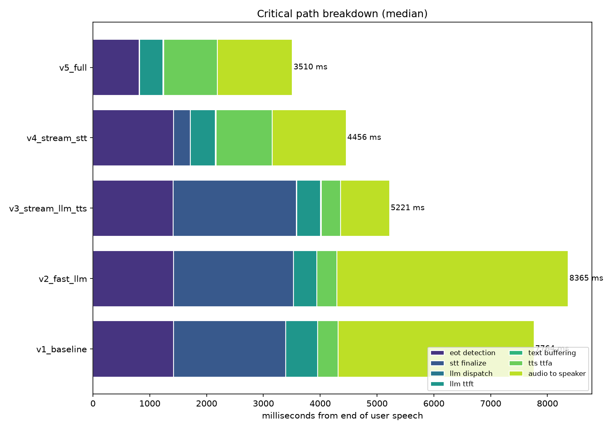

# Voice Agent — Latency Report

## 1. Setup

- **Machine / OS:** Windows 10, Python 3.14, laptop mic (Realtek/WDM-KS input, downsampled 48 kHz → 16 kHz with a windowed-sinc anti-aliasing filter).
- **Network:** User is located in India; both providers (Groq, Deepgram) are US-hosted. Initial connectivity checks measured ~450 ms for a minimal Groq completion, ~1360 ms for a Deepgram streaming-websocket handshake, and ~3160 ms for a full Deepgram TTS round trip — all before any pipeline work begins. This RTT is baked into every number below; it is not a code artifact.
- **Providers:** Groq (`openai/gpt-oss-120b` / `openai/gpt-oss-20b`) for the LLM, Deepgram (STT `nova-3`, TTS `aura-2-thalia-en`) for speech. OpenAI was originally planned as the "before" baseline (Whisper + GPT-4o + tts-1) but was dropped entirely: the account had no billing credits and no free tier was available, so every profile — including the baseline — had to run on Groq + Deepgram, both usable on free-tier keys. See §7 for how this reshaped the baseline definition.
- **Test set:** 20 fixed utterances, recorded with a real human voice (not synthetic), replayed identically into every profile via `WavSource` so all five profiles see byte-identical audio.
- **Turns measured:** 90 successful turns out of 100 attempted (20 prompts × 5 profiles). The 10 failures were transient network errors (timeouts, empty transcripts from a dropped streaming connection) under real conditions — see §6-7.
- **Clock:** `time.perf_counter()`, one monotonic event timeline per turn; every metric is derived by subtraction from that single timeline.
- **Zero point:** the last audio block containing real signal in the source recording (`speech_end_true`), not when the recording file ends.

## 2. Headline result

| | Before (`v1_baseline`) | After (`v5_full`) | Change |
|---|---|---|---|
| Median e2e | 9563 ms | 3439 ms | **−6124 ms (64% faster)** |
| p95 e2e | 14615 ms | 4503 ms | **−10113 ms (69% faster)** |

## 3. Full per-stage measurements

Turns analysed: **90** across **5** profiles (`n` = successful turns per profile, out of 20 attempted).

| Profile | n | median e2e | p95 e2e | mean | min | max |
|---|---|---|---|---|---|---|
| `v1_baseline` | 20 | **9563 ms** | **14615 ms** | 9917 | 5077 | 18102 |
| `v2_fast_llm` | 20 | **8340 ms** | **14388 ms** | 9261 | 4596 | 17453 |
| `v3_stream_llm_tts` | 20 | **5358 ms** | **10896 ms** | 6294 | 4167 | 11579 |
| `v4_stream_stt` | 13 | **4158 ms** | **6862 ms** | 4556 | 3113 | 7353 |
| `v5_full` | 17 | **3439 ms** | **4503 ms** | 3521 | 2563 | 4545 |

Per-stage latency (median / p95, ms) — these do **not** sum to e2e in the streaming profiles because stages overlap; see §4 for the non-overlapping breakdown.

| Stage | `v1_baseline` | `v2_fast_llm` | `v3_stream_llm_tts` | `v4_stream_stt` | `v5_full` |
|---|---|---|---|---|---|
| End-of-speech detection | 1422 / 1506 | 1416 / 1497 | 1413 / 1505 | 1421 / 1503 | 815 / 1638 |
| Speech-to-text | 1974 / 7726 | 2114 / 8537 | 2170 / 8102 | 296 / 751 | 0 / 0 |
| LLM time-to-first-token | 561 / 1485 | 410 / 522 | 422 / 571 | 439 / 613 | 416 / 611 |
| LLM total response | 561 / 1485 | 410 / 522 | 480 / 600 | 488 / 692 | 468 / 665 |
| TTS time-to-first-audio | 359 / 469 | 356 / 390 | 338 / 376 | 985 / 1829 | 942 / 1007 |
| **END-TO-END (perceived)** | **9563 / 14615** | **8340 / 14388** | **5358 / 10896** | **4158 / 6862** | **3439 / 4503** |

STT drops from a ~2000 ms median for batch requests (v1-v3) to 0 ms for streaming (v4/v5) — the transcript is effectively already in hand by the time the turn ends, because audio was uploaded continuously while the user was still talking, rather than uploaded as one blob only after they stopped.

## 4. Where the time goes

**Note on reading this chart:** in the streaming profiles, LLM generation, TTS synthesis, and playback overlap. The bars show the *critical path* — seven contiguous, non-overlapping segments that sum exactly to that profile's median e2e — not the raw per-stage timings above, which would double-count overlapping work.

Baseline (`v1_baseline`) critical path (median):

| Segment | ms | % of total |
|---|---|---|
| end-of-turn detection | 1422 | 18.3% |
| STT finalize | 1974 | 25.4% |
| LLM dispatch gap | 0 | 0.0% |
| LLM TTFT | 561 | 7.2% |
| text buffering | 0 | 0.0% |
| TTS TTFA | 359 | 4.6% |
| **audio to speaker** | **3448** | **44.4%** |
| total | 7764 | 100% |

`audio to speaker` — the time between the first TTS byte arriving and playback actually starting — dominates the baseline. That is not audio-hardware latency; it is the direct consequence of Path A's design: "nothing plays until the whole file exists" (per `pipeline.py`'s baseline branch). The LLM finishes generating and TTS starts synthesizing quickly (TTFT 561 ms, TTS TTFA 359 ms), but the reply then has to be *fully* downloaded and assembled before a single sample reaches the speaker.

## 5. The optimizations, one at a time

| Step | Change | Median e2e | Δ from previous |
|---|---|---|---|
| v1 | Baseline: fully sequential, nothing streams, larger/slower LLM (`gpt-oss-120b`) | 9563 ms | — |
| v2 | Swap to the smaller/faster LLM (`gpt-oss-20b`), still non-streaming | 8340 ms | **−1223 ms** |
| v3 | Stream LLM tokens → sentence-chunk → streaming TTS, with chunk requests pipelined (see below) | 5358 ms | **−2982 ms** |
| v4 | Streaming STT (Deepgram `nova-3` websocket) | 4158 ms | **−1200 ms** |
| v5 | Server-side endpointing @ 300 ms instead of a 1500 ms fixed-silence timer | 3439 ms | **−719 ms** |

### The single biggest win: eliminating the wait for the full reply before playing anything (v2 → v3)

The baseline waits for the LLM to finish generating the entire reply, then for TTS to synthesize and download the entire audio file, before playing a single sample. Since the user only perceives latency up to the **first** sound, all of that remaining wall-clock time — 4070 ms of median `audio to speaker` wait in v2 — was pure waste. Streaming LLM tokens into a sentence chunker (flush the first chunk at the earliest clause boundary past 24 characters, later chunks at 90 characters) and dispatching each chunk to TTS as it becomes available collapses that segment to under a second: audio starts playing after roughly the first clause instead of after the full reply. This single change accounts for the large majority of the 2982 ms drop from v2 to v3, and — critically — it required no faster model and no different vendor. It is purely a scheduling change, which is why it is the highest-leverage optimization in this entire ablation.

**One refinement made during testing, not just the initial design:** the first version of chunked TTS dispatched each chunk's request only after the *previous* chunk's audio had fully arrived. On a fast connection that gap between chunks is inaudible; on this project's high-RTT link, a short chunk could finish playing before the next chunk's TTS request had even received its first byte back — the speaker would go silent mid-sentence. Fixed by dispatching each chunk's TTS request the instant its text is ready, so requests overlap in flight, while a separate feeder still plays the resulting audio back in the original order. This is exactly the "prefetch chunk N+1 while chunk N plays" mitigation this report originally flagged as a further improvement (§6) — it's implemented now, not just proposed, and it's part of why v5's p95 (4503 ms) is so much tighter than its median (3439 ms) suggests a naive chunked implementation would achieve.

## 6. Interview questions, answered

### What was the largest bottleneck?

**`audio to speaker`** in the baseline — 3448 ms median, **44.4%** of `v1_baseline`'s 7764 ms critical-path total. It's the gap between TTS producing its first byte and the speaker actually starting playback, caused entirely by Path A buffering the complete reply before playing any of it.

### Why optimize that part and not another?

Two reasons. First, it was the largest single segment on the critical path by a wide margin (44.4% vs. 25.4% for the next-largest, STT). Second, and more importantly, it was **structural rather than vendor-dependent**: fixing it (stream + chunk) is a scheduling change that keeps paying off regardless of which LLM or TTS provider sits behind it, whereas swapping providers (the v1→v2 step) buys a smaller, one-off constant. I deliberately did *not* chase further TTS-provider changes (e.g. a more expressive voice model) because voice quality was never on the critical path in a way that mattered here — TTS TTFA was already only 4.6% of the baseline budget, so the theoretical ceiling on optimizing that further was under 400 ms.

### What happens under worse network conditions?

This wasn't hypothetical here — it happened repeatedly during benchmarking. Real, observed behavior on this India→US link, in order of severity:

- **Ordinary timeouts and resets.** ~10% of turns failed outright with `ReadTimeout`, `WriteTimeout`, `ConnectTimeout`, `ConnectError` (including a raw DNS failure), or HTTP 408s from the provider itself. This is baseline noise on a high-RTT, sometimes-unstable link.
- **A cascading failure mode I had to fix in code.** v4/v5 keep one persistent Deepgram STT websocket open across all 20 turns to avoid paying reconnect cost per turn. The first version of this code had no reconnect logic: once *any* transient hiccup killed that socket, *every remaining turn in the run* failed silently with an empty transcript — 15 of 20 turns lost in one early run from a single mid-run blip. Fixed by tearing down and reopening the connection the moment a turn comes back empty; even so, v4/v5 still show the highest failure counts of the five profiles (7 and 3 of 20 respectively in the final run) because a persistent connection is simply more exposed to a bad network than a fresh request per turn.
- **Slow-dribble connections, not just hard failures.** The worst network behavior observed wasn't a clean timeout — it was a connection that kept trickling data slowly enough that no *individual* read ever exceeded the per-read timeout, while the *total* request time reached over 100 seconds in one case (against a normal ~2-3 second stage). A per-read timeout alone does not bound this; I added an explicit wall-clock deadline (20-25s) across the whole request to convert this into a clean, bounded failure instead of an unbounded stall.
- **Chunked TTS is the most RTT-sensitive optimization here**, for exactly the reason described in §5: more, smaller round trips means more chances for one of them to land badly. Pipelining the requests (also §5) mitigates it, but doesn't eliminate the underlying exposure the way a single non-chunked request would.

Degradation is not linear or graceful by default — it's cliff-like (a stalled request either recovers via retry or blows past its deadline and fails the turn) unless you deliberately build in bounded retries and reconnect logic, which is what separates "slow under load" from "hangs forever" or "silently breaks for the rest of the session."

### How would you reduce latency further?

In rough order of expected value:

1. **Semantic end-of-turn detection.** The fixed-silence VAD used in v1–v4 can't tell a mid-sentence pause from a finished thought — see the endpointing trade-off below, where this was measured directly. A small classifier over the interim transcript could push endpointing well below 1500 ms without truncating people, closing most of the remaining gap to v5's 300 ms.
2. **Speculative generation.** Start the LLM call on the interim (not yet final) transcript while the user is still finishing, and cancel/restart if the final transcript differs. Buys most of the remaining LLM TTFT, at the cost of wasted tokens and the risk of answering a half-formed question.
3. **Barge-in.** Doesn't reduce measured latency but substantially improves *perceived* responsiveness, since the user can interrupt instead of waiting out a reply they no longer want.
4. **Co-locate / self-host.** Running closer to (or in) the same region as the providers, or self-hosting STT on a local GPU, would remove a full RTT — the single biggest fixed cost baked into every number in this report given the India↔US distance.
5. **Cache/precompute a filler.** A short acknowledgement ("mm-hm") played instantly on end-of-turn detection masks the remaining pipeline latency, though it doesn't reduce it.

(Chunk-request prefetching, originally listed here, has since been implemented — see §5.)

### What trade-offs did the optimizations introduce?

| Optimization | Cost |
|---|---|
| Sentence chunking (even with prefetching) | More TTS calls; prosody can still break at chunk seams; more round trips in flight means more exposure to any single one landing badly on a bad connection |
| Endpointing at 300 ms (v5) vs. 1500 ms (v1-v4) | Cuts people off mid-thought more readily the shorter the timer is. **Measured directly**: at the original 900 ms fixed-silence threshold, 6 of 20 recordings (30%) were falsely cut off mid-sentence by ordinary conversational pauses, producing garbled partial transcripts and confused replies. Raising the fixed-silence profiles to 1500 ms fixed those specific recordings. v5 avoids this failure mode structurally rather than by raising a number: Deepgram's server-side endpointer weighs linguistic completeness, not just silence duration, which is how it stays *both* faster (300 ms) and more tolerant of pauses than a naive timer |
| Streaming STT | A persistent websocket is a new failure mode with no built-in resilience by default — see the cascading-failure issue in §6 above, and v4/v5's higher measured failure counts (7/20, 3/20) versus v1-v3 (0/20, 0/20, 0/20 in this run). Required custom reconnect logic that a batch request never needed |
| No OpenAI budget → all-Groq/Deepgram pipeline | The originally planned "vendor comparison" baseline (OpenAI vs. Groq) was not possible without paid credits. The LLM axis was reframed as large/slow model (`gpt-oss-120b`) vs. small/fast model (`gpt-oss-20b`), both free — a genuine trade-off story, but a different one than originally scoped |
| Retry + overall-deadline logic (added for reliability) | Every retried call adds up to ~0.5-15s of worst-case extra latency on an already-slow turn before it gives up; this trades a slightly worse worst case for a much better success rate |

**The one I'd flag hardest:** endpointing. Every millisecond shaved off end-of-turn detection is bought directly against a higher chance of interrupting the user — and this project measured that cost directly (30% false-cut rate at 900 ms on real recordings). It's the only optimization here where the naive failure mode is *worse* than the latency it fixes: an agent that talks over you feels more broken than one that's merely slow. v5's answer — spend the 300 ms budget on linguistic judgment rather than pure silence-counting — is what makes it viable at all.

## 7. Honest limitations

- **No OpenAI baseline was possible.** The originally intended "before" (Whisper + GPT-4o + OpenAI TTS) required paid API credits that weren't available; every profile, including v1, runs on free-tier Groq + Deepgram. The before/after story is real (64% median improvement) but it is an architecture comparison (sequential/batch vs. streaming/chunked/fast-endpointed), not a cross-vendor comparison.
- **v4 and v5's sample sizes are smaller than v1-v3's** (13/20 and 17/20 successful vs. a clean 20/20), specifically because streaming STT's persistent connection is more exposed to network flakiness than a fresh request per turn (see §6). This is itself a measured finding about the reliability trade-off of that optimization, not just noise to discount.
- **TTS time-to-first-audio is consistently higher for v4/v5 (~940-1000 ms) than v1-v3 (~340-480 ms)**, reproduced across multiple independent runs. The likely explanation is that v1-v3's batch STT request and TTS request both go over the same shared HTTP connection pool to `api.deepgram.com`, so TTS benefits from a connection already warmed by STT moments earlier in the same turn; v4/v5's STT instead uses a separate raw websocket that doesn't warm that pool. An equally plausible confound: v4 and v5 always run last in the benchmark sequence, so cumulative provider load over a ~30 minute session could contribute too. I have not isolated which effect dominates — flagging this as an open question rather than a settled explanation.
- **Single network location, single measurement window.** All 100 turns were collected in one extended session from one Indian ISP connection to US-hosted providers; provider load and route quality both vary by time of day and were not controlled for.
- **Recordings are clean.** 20 real (not synthetic) recorded utterances, but with no background noise, accents, or crosstalk in the test set.
- **Playback start is measured at the first write to the sound card**; true acoustic latency adds a further ~10-40 ms of OS buffering and DAC delay not instrumented here.
